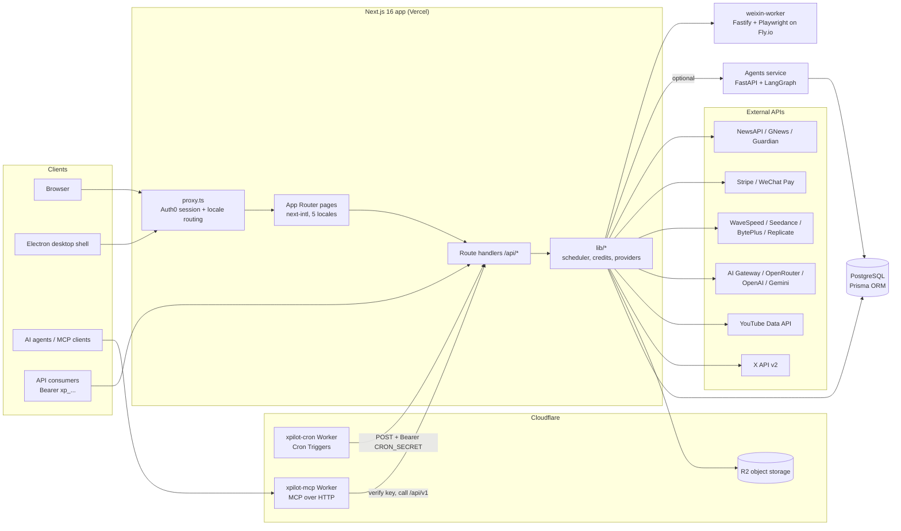

# xPilot

**An AI copilot for social media marketing: it learns your brand from your own content, writes and schedules posts for X and YouTube, and generates the images and videos to go with them.**

Live: **https://xpilot.jytech.us**

Small teams that market on X usually juggle a scheduler, a chatbot, an image or video generator and an analytics tab, and none of them knows anything about the brand. xPilot puts those steps in one product. You point it at your website (or a WeChat Channel), and it builds a knowledge base and a "content profile" from your past posts. It then drafts on-brand posts and threads, scores and hashtags them, and publishes them on a schedule or on a recurring cadence. A shared credit ledger meters every AI call: text, image, video and TTS.

---

## Features

All of the features below are implemented in this repository.

**Content and publishing**
- Knowledge base built from websites (Cheerio scraper, multi-page) and WeChat Channels (via a separate headless-browser worker)
- AI post generation in several languages, with a per-user content profile derived from past posts, trending-topic injection by region, and recent-post de-duplication in the prompt
- Thread generation (3 to 7 tweets), AI hashtag optimization within 280 characters, and A/B scoring of candidate posts by predicted engagement
- One-off scheduled posts and recurring schedules (hourly presets, daily, weekly or monthly) for X, with optional AI generation and image attachments at run time
- Multiple X accounts per user, connected through OAuth 1.0a or bring-your-own API keys
- YouTube video upload and recurring YouTube schedules (Google OAuth2 with token refresh)
- Engagement helper: finds your recent posts that have replies and drafts AI responses, with a daily reply cap

**Media Studio**
- Text-to-image, image-to-image, text-to-video and image-to-video across several model providers (WaveSpeed, Seedance, BytePlus, OpenRouter)
- Long-form video: an LLM plans the segments, each segment is generated in turn and seeded with the previous segment's last frame for continuity, and the segments are stitched with ffmpeg. Single segments can be retried.
- Post-production tools: TTS and narration (OpenAI), background music, video stitching, AI video editing and SAM-based segmentation (Replicate)
- Public gallery with likes, comments and user follows

**Analytics and monitoring**
- Follower snapshots and growth charts, tweet-metric sync, and per-post performance
- Keyword and sentiment monitoring on X (track, negative and competitor keywords), with AI analysis and shareable snapshots
- Automated daily and weekly media-industry news reports and X-account digest reports (NewsAPI, GNews and Guardian sources, summarized with Gemini)

**Business and platform**
- Credit ledger with per-model cost accounting, subscription-tier discounts, and team credit pools with transfers
- Stripe subscriptions, top-ups and ACH; Stripe Connect payouts; WeChat Pay checkout
- Client campaigns: materials, attachments, AI analysis and budget estimates, plus a tokenized share link where the client can pay
- Referral codes with commission tracking, and a daily check-in streak
- AI Studio chat assistant with tool calling. Its tools are read-only or draft-only and never publish.
- Public REST API (`/api/v1`) with hashed API keys and per-key rate limiting, plus an MCP server that exposes generation tools to AI agents
- UI in 5 languages (en, zh, es, ja, ko)
- Windows desktop app: an Electron shell around the hosted app, with native notifications ([docs/electron.md](docs/electron.md))

---

## Architecture



**Request path.** `proxy.ts` (the Next.js 16 replacement for middleware) runs the Auth0 middleware first so that session cookies are always refreshed. It then applies `as-needed` locale routing: `/` is served as English, and `/zh/...` and other locales are prefixed.

**Background work.** The Next.js app runs no long-lived processes. Every recurring job is a stateless HTTP endpoint guarded by `CRON_SECRET`, and an external Cloudflare Worker calls it:

| Trigger (UTC) | Endpoints |
| --- | --- |
| Every 2 min | `/api/toolbox/tasks/process` (poll media jobs), `/api/cron/recurring-youtube`, `/api/scheduler/youtube-post` |
| 01:00, 13:00, 23:00 | `/api/scheduler` (scheduled + recurring X posts) |
| 01:00 | `/api/daily-generate`, `/api/cron/media-news` (daily; weekly on Mondays), `/api/cron/snapshot-followers` |
| 23:00 | `/api/cron/media-x` (daily; weekly on Sundays) |

Every run is recorded in a `CronRunEvent` table, which stores the job, trigger source, duration, status and error, for the admin dashboard.

---

## Key engineering decisions

- **Cron lives outside the app.** Scheduling runs in a Cloudflare Worker that POSTs to authenticated route handlers. It does not use Vercel Cron or an in-process `node-cron`. This keeps every job a plain, stateless HTTP call that can be re-run by hand (`curl` with the bearer secret), tested locally, and moved to another host. The Cloudflare free plan allows 5 triggers per account, so one 2-minute trigger fans out to the jobs, and the worker gates them by UTC hour. `scripts/scheduler.ts` is kept as a `node-cron` fallback for local or self-hosted runs.
- **Async media generation is a DB-backed state machine, not a long request.** Video providers take minutes to finish, which is longer than a serverless function can run. A submission writes a `MediaTask` row (with `provider`, `providerTaskId` and `pollAttempts`) and returns immediately. The 2-minute cron polls up to 50 pending tasks per run, persists the outputs to R2, and fails a task after a capped number of attempts. The task stores the provider, so polling goes to the provider that accepted the job. Long-form videos (`VideoJob`) store their per-segment state as JSON, which makes individual segments retryable and lets stitching resume.
- **Money paths are atomic.** Credit deductions use a conditional `updateMany ... where balance >= cost` with `decrement`, so concurrent AI calls cannot push a balance below zero, and every movement is written to a `CreditTransaction` ledger. Teams have a separate pool with transfer records. Cost is computed per model from token usage, falling back to a conservative character-based token estimate when a provider returns no counts. Provider charge multipliers are set in env, not in code.
- **Secrets are encrypted, API keys are hashed.** Users' X and provider credentials are stored with AES-256-GCM (random IV plus auth tag, key from `ENCRYPTION_KEY`). Public API keys (`xp_...`) are stored only as SHA-256 hashes, with a display prefix, expiry and revocation. During OAuth 1.0a, the token secret sits in a short-lived httpOnly cookie instead of the database. Media URLs go through an HMAC-signed, expiring proxy, and only the raw URL is stored, so links are re-signed when read.
- **Provider abstraction over provider lock-in.** Text generation goes through the Vercel AI SDK, with the AI Gateway as the default and OpenRouter for `openrouter/*` model IDs, so changing models is a config change. Video goes through `lib/video-provider.ts`, which routes by model ID across WaveSpeed, Seedance and BytePlus. Storage uses R2 behind a wrapper that matches the `@vercel/blob` API, so moving from Blob to R2 required no changes to the code that calls it.
- **Heavy or awkward workloads run as separate services.** WeChat Channels needs a real logged-in browser, so scraping and QR login run in `weixin-worker` (Fastify + Playwright on Fly.io, scale-to-zero). The multi-agent content pipeline (Database Manager, then Author, then Editor, built on LangGraph) is an optional Python service. The app uses it when `AGENT_SERVICE_URL` is set and otherwise falls back to direct LLM calls. The MCP server is a thin Cloudflare Worker that verifies keys against the main app and calls `/api/v1`, so the business logic exists only in the app.

### Known limitations

These are documented here so readers know about them:
- Scheduled X posts are published during the three scheduler windows (01:00, 13:00 and 23:00 UTC), not at the exact minute. YouTube posts and media tasks run every 2 minutes.
- Post publishing uses status transitions (`scheduled` to `posted` or `failed`) without a row-level claim or lock. Overlapping scheduler runs could therefore double-post. A `SELECT ... FOR UPDATE SKIP LOCKED` or a conditional status claim is the planned fix.
- Test coverage is light: there is one Playwright E2E spec for Media Studio routing.

---

## Tech stack

| Layer | Technology |
| --- | --- |
| Framework | Next.js 16 (App Router, route handlers, `proxy.ts`), React 19, TypeScript |
| Styling / UI | Tailwind CSS 4, Recharts, react-markdown |
| i18n | next-intl (en, zh, es, ja, ko) |
| Auth | Auth0 (`@auth0/nextjs-auth0` v4), role and admin claims |
| Database | PostgreSQL via Prisma 6 (27 migrations) |
| Background jobs | Cloudflare Workers Cron Triggers |
| Storage | Cloudflare R2 (S3 API), Vercel Blob (legacy), Postgres bytes for post attachments |
| AI (text) | Vercel AI SDK + AI Gateway, OpenRouter, OpenAI, Google Gemini |
| AI (media) | WaveSpeed, Seedance, BytePlus, Replicate, OpenRouter image models; ffmpeg for stitching |
| Social APIs | `twitter-api-v2` (X), `googleapis` (YouTube) |
| Payments | Stripe (subscriptions, Checkout, ACH, Connect), WeChat Pay |
| Email | Brevo |
| Agents service | Python 3.11, FastAPI, LangChain / LangGraph, SQLAlchemy (asyncpg) |
| WeChat worker | Fastify, Playwright, Fly.io |
| Agent interface | Model Context Protocol (`@modelcontextprotocol/sdk`) |
| Desktop | Electron + electron-builder (Windows NSIS / portable) |
| Testing / CI | Playwright; GitHub Actions for the Windows desktop build |

---

## Project structure

```
app/               Next.js App Router: [locale]/ pages and api/ route handlers (~155 endpoints)
components/        React components (dashboard, Media Studio toolbox, chat, landing)
lib/               Domain logic: scheduler, X/YouTube clients, AI + media providers, credits, Stripe, encryption
prisma/            Prisma schema and SQL migrations (PostgreSQL)
i18n/, messages/   next-intl routing config and translation catalogs
proxy.ts           Auth0 session middleware + locale routing
cloudflare-cron/   Cloudflare Worker that drives all scheduled jobs
workers/mcp/       Cloudflare Worker exposing xPilot as an MCP server
agents/            Optional Python multi-agent content service (FastAPI + LangGraph, Dockerfile)
weixin-worker/     WeChat Channels scraper / QR-login service (Fastify + Playwright, Fly.io)
electron/          Desktop shell (main, preload, native notifications)
skills/            Standalone agent skill: scripted 30-second ad video generator
scripts/           Ops and maintenance scripts (Stripe plan setup, backfills, local scheduler)
tests/e2e/         Playwright end-to-end tests
docs/              Additional docs (desktop app, cron worker)
```

---

## Local development

### Prerequisites
- Node.js 20+ (22 recommended)
- PostgreSQL 14+ (local, or a hosted instance such as Neon)
- An Auth0 application (Regular Web App)
- Optional: Python 3.11+ for `agents/`, and the Wrangler CLI for the Cloudflare workers

### Environment variables

Create `.env.local` in the repo root. The list below gives names only. Features whose keys are missing are disabled or will error when called.

| Group | Variables |
| --- | --- |
| Core | `DATABASE_URL`, `ENCRYPTION_KEY` (64 hex chars), `CRON_SECRET`, `APP_BASE_URL`, `NEXT_PUBLIC_APP_URL` |
| Auth0 | `AUTH0_DOMAIN`, `AUTH0_CLIENT_ID`, `AUTH0_CLIENT_SECRET`, `AUTH0_SECRET`; optional `AUTH0_ROLES_CLAIM`, `AUTH0_PERMISSIONS_CLAIM`, `ADMIN_EMAILS` |
| X | `TWITTER_API_KEY`, `TWITTER_API_SECRET` (app keys for OAuth 1.0a connect) |
| AI text | `AI_GATEWAY_API_KEY`, `OPENAI_API_KEY`, `OPENROUTER_API_KEY`, `GEMINI_API_KEY` |
| AI media | `WAVESPEED_API_KEY`, `SEEDANCE_API_KEY`, `BYTEPLUSES_API_KEY`, `REPLICATE_API_KEY` |
| Storage | `R2_ACCOUNT_ID`, `R2_ACCESS_KEY_ID`, `R2_SECRET_ACCESS_KEY`, `R2_BUCKET_NAME`, `R2_PUBLIC_URL`, `BLOB_PROXY_SECRET`, `BLOB_READ_WRITE_TOKEN` |
| Payments | `STRIPE_SECRET_KEY`, `STRIPE_WEBHOOK_SECRET`, `STRIPE_PRICE_*` (per tier, monthly/yearly) |
| News | `NEWS_API_KEY`, `GNEWS_API_KEY`, `GUARDIAN_API_KEY` |
| Services | `AGENT_SERVICE_URL`, `AGENT_API_SECRET`, `WEIXIN_WORKER_URL`, `WEIXIN_WORKER_SECRET`, `BREVO_API_KEY` |
| Pricing | `OPENAI_CHARGE_MULTIPLIER`, `WAVESPEED_*_CHARGE_MULTIPLIER` (and `NEXT_PUBLIC_` mirrors) |

Generate an encryption key with `openssl rand -hex 32`.

### Database

```bash
npm install            # also runs `prisma generate`
npx prisma migrate deploy
```

### Run

```bash
npm run dev            # http://localhost:3000
npm run scheduler      # optional: local node-cron loop that runs the post scheduler every minute
```

To trigger a cron job by hand:

```bash
curl -X POST http://localhost:3000/api/scheduler -H "Authorization: Bearer $CRON_SECRET"
```

### Test

```bash
npx playwright install chromium
npm run test:e2e       # starts the dev server automatically if one isn't running
npm run lint
```

### Optional services

```bash
# MCP worker
npm run mcp:dev

# Python agents service
cd agents && pip install -e . && uvicorn app.main:app --reload

# Desktop shell against local dev
npm run electron:dev
```

---

## Deployment

- **Web app:** Vercel. The build is `prisma generate && next build`. Run `prisma migrate deploy` against production before you deploy a schema change.
- **Cron worker:** `cloudflare-cron/` is deployed with Wrangler and needs the `APP_BASE_URL` and `CRON_SECRET` secrets. A `dev` environment runs every 5 minutes against staging. See [docs/cloudflare-cron.md](docs/cloudflare-cron.md).
- **MCP worker:** `npm run mcp:deploy`.
- **weixin-worker:** Fly.io (`weixin-worker/fly.toml`, Dockerfile).
- **Agents service:** container image from `agents/Dockerfile`, on any container host.
- **Desktop:** a GitHub Actions workflow builds the Windows installer and portable `.exe` and publishes them to GitHub Releases ([docs/electron.md](docs/electron.md)).
- **Stripe:** point a webhook at `/api/stripe/webhook` with checkout, subscription, invoice and Connect account events.
